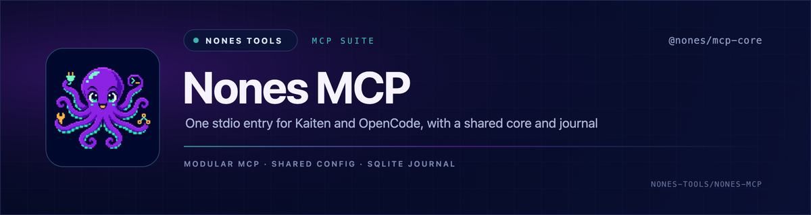

# Nones MCP

**Nones MCP** is the Bun monorepo for the `@nones` MCP suite: one shared
runtime for [Kaiten](apps/kaiten) and [OpenCode](apps/opencode), plus a local
operation journal. It is developed at
[github.com/nones-tools/nones-mcp](https://github.com/nones-tools/nones-mcp).

## Packages

| Path | Package | What it does |
| --- | --- | --- |
| `apps/core` | `@nones/mcp-core` | Command registration, runtime and journal orchestration across all MCPs; single stdio entry `nones-mcp` |
| `apps/kaiten` | `@nones/kaiten-mcp` | Kaiten MCP server, `kaiten` CLI and typed SDK, with a `./module` export |
| `apps/opencode` | `@nones/opencode-mcp` | OpenCode 2 MCP server, CLI and SDK, with a `./module` export |
| `adapters/journal` | `@nones/journal` | Journal adapter implementations, including the built-in SQLite adapter at `@nones/journal/sqlite` |

`compat/*` contains historical wrappers kept for reference; they are not
workspaces.

Read [ARCHITECTURE.md](ARCHITECTURE.md) before changing anything. The
[Nones Tools profile](docs/organization/profile/README.md) describes the suite
and links the legacy Kaiten and OpenCode histories.

## Verify

```sh
bun install --frozen-lockfile
bun run verify   # build → typecheck → lint → tests → pack:check
```

Tests run with an isolated `HOME` (`scripts/test.ts`), so a real
`~/.kaiten/config` cannot influence results. No network, credentials, or live
OpenCode/Kaiten calls are required.

## Serve

```sh
node apps/core/dist/bin.js doctor
node apps/core/dist/bin.js          # stdio MCP; stdout is protocol-only
```

Configuration lives in `NONES_CONFIG_DIR`, else `$XDG_CONFIG_HOME/nones`, else
`~/.config/nones`: shared `config.json` and private `modules/<id>.json`.
Credentials go through `envFrom`, never literal values. See ARCHITECTURE.md §7
for the local cutover shape.

## Rules

- Keep public names, bins, exports and independent versions.
- Do not load code from CWD or download packages at runtime.
- Do not mutate `process.env` to inject module credentials.
- Keep journal orchestration and policy in core; adapters own durable storage.
- Keep standalone MCP and CLI entrypoints working during cutover.

## Documentation

- [Architecture and source migration](ARCHITECTURE.md)
- [Kaiten MCP](apps/kaiten/README.md) — [tools](apps/kaiten/docs/tools.md),
  [CLI](apps/kaiten/docs/cli.md), [configuration](apps/kaiten/docs/configuration.md),
  [SDK](apps/kaiten/docs/sdk.md)
- [OpenCode MCP](apps/opencode/README.md) — [specification](apps/opencode/docs/SPECIFICATION.md),
  [contributing](apps/opencode/CONTRIBUTING.md)
- [Built-in SQLite journal adapter](docs/adapters/sqlite.md)
- [Organization profile source](docs/organization/profile/README.md) and
  [legacy redirect text](docs/organization/legacy/README.md)

## License

MIT
