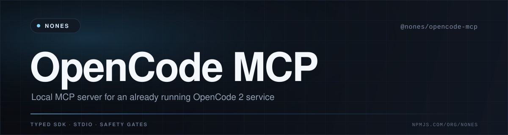

[](https://www.npmjs.com/org/nones)

# OpenCode MCP

`@nones/opencode-mcp` is a local MCP server, Node CLI, and TypeScript SDK for an **already running** OpenCode 2 service. The initial compatibility target is OpenCode 2.4.1. It connects to the service that is already there and never starts, restarts, or replaces it. Node 22.14 or newer is required for the packaged CLI.

## Quick start

Install globally and check the connection:

```sh
npm install -g @nones/opencode-mcp
opencode-mcp doctor
```

`opencode-mcp mcp` runs the stdio MCP server and is the default when no command is given. `opencode-mcp doctor` reads `server.info` and reports available operations as indented JSON without printing credentials. `opencode-mcp help`, `--help`, and `-h` show built-in help; `--version` and `-V` report 0.2.1 from package metadata. In `mcp` mode, stdout carries JSON-RPC traffic only; use stderr for diagnostics.

## Set up with an agent

Copy this prompt into your MCP-capable coding agent, replacing `<client name>` with the client you intend to configure:

```text
Set up @nones/opencode-mcp for <client name> on this machine.
1. Confirm Node 22.14+ and an already running OpenCode 2 service. Never start or replace the service.
2. Install the latest stable package globally with npm install -g @nones/opencode-mcp.
3. Register a user-level stdio MCP server with id opencode2 using <client name>'s documented configuration method. Preserve unrelated entries, reuse an equivalent registration, and verify no duplicates.
4. Use the host-accessible executable (absolute path if needed) with argument mcp. Keep managed discovery and add service file, URL, or auth overrides only if this setup needs them. Do not expose credential values in docs, arguments, logs, or config.
5. Keep destructive, admin, and exec capabilities off. Run opencode-mcp doctor, then confirm the client can call the MCP tool opencode_server_info.
6. Report install and config locations and whether the client needs a restart.
```

## Client registration

### Codex

Prefer the built-in registration command, which writes the user-level config:

```sh
codex mcp add opencode2 -- opencode-mcp mcp
```

The corresponding `~/.codex/config.toml` entry is:

```toml
[mcp_servers.opencode2]
command = "opencode-mcp"
args = ["mcp"]
```

### Generic stdio client

Any MCP client that can launch a stdio server can use this user-level config:

```json
{
  "mcpServers": {
    "opencode2": {
      "command": "opencode-mcp",
      "args": ["mcp"]
    }
  }
}
```

## Connection and configuration

With no configuration, the CLI discovers the authenticated managed service through the official `@opencode/client/service` adapter. `OPENCODE_MCP_SERVICE_FILE` can point to a non-default OpenCode-managed registration file. An explicit endpoint uses `OPENCODE_MCP_URL` and, when needed, Basic authentication as user `opencode`.

| Variable                         | Purpose                                                                                                                                                |
| -------------------------------- | ------------------------------------------------------------------------------------------------------------------------------------------------------ |
| `OPENCODE_MCP_URL`               | Use an explicit endpoint instead of discovery. Loopback is the default; a remote host requires HTTPS and `OPENCODE_MCP_ALLOW_REMOTE=1`.                |
| `OPENCODE_MCP_PASSWORD`          | Basic-auth password for user `opencode` when `OPENCODE_MCP_URL` is set. Pass it through the environment, never a committed config or command argument. |
| `OPENCODE_MCP_SERVICE_FILE`      | Path to an OpenCode-managed service registration passed to the discovery adapter.                                                                      |
| `OPENCODE_MCP_ALLOW_REMOTE`      | Set to `1` to allow a remote HTTPS endpoint.                                                                                                           |
| `OPENCODE_MCP_TIMEOUT_MS`        | Request timeout from 100 to 120000 ms. Default: 30000.                                                                                                 |
| `OPENCODE_MCP_ALLOWED_DIRS`      | Platform path-delimited list of existing directories that bounds project and session scope.                                                            |
| `OPENCODE_MCP_ALLOW_DESTRUCTIVE` | Set to `1`, plus per-call `confirm: true`, to allow deletion, filesystem writes, and rollback/commit operations.                                       |
| `OPENCODE_MCP_ALLOW_ADMIN`       | Set to `1`, plus `confirm: true`, to allow plugin updates, global configuration, and other unclassified mutations.                                     |
| `OPENCODE_MCP_ALLOW_EXEC`        | Set to `1`, plus `confirm: true`, to allow explicit shell, command, and PTY operations.                                                                |

Capability flags enable only when the value is exactly `1`; any other value leaves the capability off. Confirmation must be exactly `true`.

## Safety and scope

- Requests use the configured origin, reject redirects, and are bounded by timeout and response size. A timed-out mutation may already have completed; check its outcome before retrying.
- `OPENCODE_MCP_ALLOWED_DIRS` is checked against canonical paths. Session and project lists are filtered to allowed workspaces, creation requires an allowed `body.location.directory` and checks any parent session, and unverifiable scope fails closed. The scope filter is not a multi-user isolation boundary; all projects and chats on the attached server are visible by default.
- Credential, authorization provisioning, pairing, and RPC tunnel routes are excluded, and sensitive fields are stripped from responses and errors.
- MCP clients can see chat content and tool output, so attach only trusted clients. Never put passwords in command arguments or committed configuration.

## Tools

| Tool                      | Use                                                                                                                               |
| ------------------------- | --------------------------------------------------------------------------------------------------------------------------------- |
| `opencode_operations`     | List discovered native operation IDs, methods, paths, parameter names, and safety categories. Optional `filter` narrows the list. |
| `opencode_request`        | Call exact operation ID with `{ operation, path?, query?, body?, confirm? }`.                                                     |
| `opencode_<operation_id>` | Call a native operation directly. Dots and other unsupported characters in the ID become underscores.                             |
| `opencode_history`        | Group native messages by user prompt with `{ sessionID, cursor?, limit? }`.                                                       |
| `opencode_events`         | Read a bounded slice of live or per-session log events with `{ sessionID?, source?, types?, after?, limit?, durationMs? }`.       |

The dynamic tools take the same parameters as `opencode_request` except `operation`. Inspect the catalog rather than assuming a route exists.

## Examples

### List operations and sessions

Discover session operations with `opencode_operations`:

```json
{ "filter": "session" }
```

Then call one through `opencode_request` (equivalent to `opencode_session_list` with `{}`):

```json
{ "operation": "session.list" }
```

Results are native payloads; with scope configured, project and session lists are filtered to allowed workspaces.

### Steer or queue a prompt

Call `opencode_session_prompt` with:

```json
{
  "path": { "sessionID": "ses_example" },
  "body": { "text": "Please also run the focused tests.", "delivery": "steer" }
}
```

`steer` asks the running session to accept the message; `queue` schedules it. The call returns the native admission receipt, not proof that the model started or finished. The current agent and model stay unchanged unless you switch them with native operations.

### Read grouped history

Call `opencode_history` with:

```json
{ "sessionID": "ses_example", "limit": 50 }
```

Each user prompt is grouped with the assistant steps and tool payloads that follow it:

```json
{
  "groups": [
    {
      "user": { "...": "native user message" },
      "steps": [{ "...": "native assistant or tool message" }],
      "terminal": null
    }
  ],
  "cursor": { "next": "..." },
  "beginsMidGroup": false,
  "endsMidGroup": true
}
```

`terminal` is set when the group has an idle marker. A page that starts or ends mid-group sets `beginsMidGroup` or `endsMidGroup`. Continue with the returned native cursor; when it is an object, pass `cursor.next` as the next `cursor`.

### Read live or logged events

Call `opencode_events` for a bounded live look at one session:

```json
{
  "sessionID": "ses_example",
  "source": "live",
  "types": ["session.idle"],
  "durationMs": 5000
}
```

`live` reads the volatile global stream, filters by session, and cannot replay missed events. For the native per-session log, use `source: "log"` and a cursor:

```json
{ "sessionID": "ses_example", "source": "log", "after": 42, "limit": 50 }
```

If `source` is omitted and `after` is present, the call uses the log. A log cursor is not valid for the global stream. Depending on the upstream version, the log may retain only a synchronization marker. Streams are bounded by `limit` (1–200), `durationMs` (100–30000), and response size.

## TypeScript SDK

```ts
import { OpenCodeClient } from "@nones/opencode-mcp";

const client = await OpenCodeClient.connect();
const info = await client.request({ operation: "server.info" });
```

The published declarations are self-contained per module and resolve for an external TypeScript `NodeNext` consumer. Public signatures avoid ambient globals, so the SDK does not require this repository's internal declaration files.

## Upstream behavior

- Operation IDs, parameters, and experimental surfaces come from the connected server's `/openapi.json`; inspect `opencode_operations` rather than assuming a catalog entry exists. Installed experimental surfaces are exposed as-is; unsupported upstream operations are not emulated.
- Session creation supports the native `parentID` body field when available. Parent linkage is never synthesized.
- `event.subscribe` and `experimental.session.log` are not available as direct operations; use `opencode_events`. The server never starts, restarts, replaces, or implicitly creates an OpenCode service, and it does not proxy credential, authorization, pairing, or RPC tunnel routes.

## Development

Bun 1.4.5 is the pinned build, formatting, and test runner; the published CLI runs on Node 22.14 or newer. Run `bun install --frozen-lockfile`, `bun run format:check`, `bun run lint`, `bun run typecheck`, `bun run build`, `bun test`, and `npm pack --dry-run`. `bun run test:package` packs the tarball, installs it into a fresh consumer, checks NodeNext declarations, and runs the installed Node CLI. See [CONTRIBUTING.md](CONTRIBUTING.md) for architecture and review guidance.
