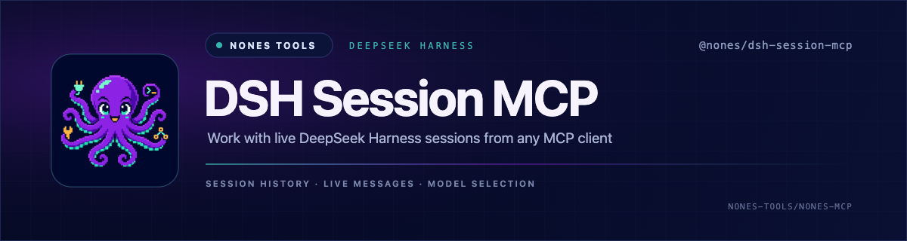
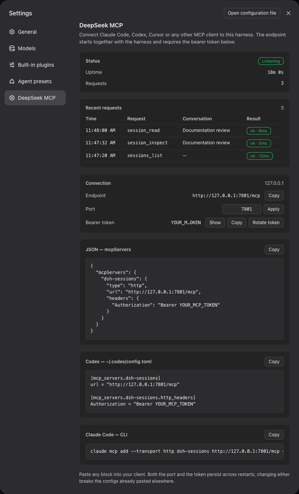

[](https://github.com/nones-tools/nones-mcp/tree/main/apps/dsh)

# @nones/dsh-session-mcp

MCP (Model Context Protocol) server for **DeepSeek Harness sessions** — lets Claude Code,
Claude Desktop, Codex, Cursor and any other MCP client work with the conversations running
in your harness: list them, read them, prompt them, branch them, stop them, retitle them,
switch their model.

Ships as a DeepSeek Harness plugin: installing the bundle starts a bearer-authenticated MCP
endpoint **together with the harness**, publishes a copy-ready client config, and adds a
**Settings → DeepSeek MCP** page with live status, the last few requests and client configuration snippets.
No sidecar process to babysit, no port to guess, no second writer on the session log.

```
┌──────────────────┐   Bearer token    ┌──────────────────────────────┐
│  Claude / Codex  │ ────────────────► │  http://127.0.0.1:7801/mcp   │
│  Cursor / other  │ ◄──────────────── │  inside the Harness process  │
└──────────────────┘   MCP over HTTP   └───────────────┬──────────────┘
                                                      │ in-process
                                                      ▼
                                           ┌─────────────────────┐
                                           │  sessionController  │
                                           │  list / page / …    │
                                           └─────────────────────┘
```

## Why

DeepSeek Harness keeps its conversations behind a writer lock: a second `dsh` process that
tries to resume a live session is rejected, and its own HTTP API authenticates with a
launch token that lives only in memory. This plugin solves both by serving MCP **inside**
the harness process, where the session controller is already available, and by giving
clients a stable bearer token instead of a launch secret.

`session_send` therefore delivers into the conversation a human is looking at, not into a
copy of it.

## Install

```bash
dsh plugin --profile desktop add @nones/dsh-session-mcp
```

From a checkout of this monorepo or straight from GitHub:

```bash
dsh plugin --profile desktop add /absolute/path/to/nones-mcp/apps/dsh
bun add github:nones-tools/nones-mcp#workspace=@nones/dsh-session-mcp
```

The published package is built from source in
[`nones-tools/nones-mcp/apps/dsh`](https://github.com/nones-tools/nones-mcp/tree/main/apps/dsh);
`bun run build` in that directory compiles `dist/` locally. `dist/` is not
tracked.

Restart the harness (or reload the profile) and the endpoint starts with it.

> The Host half (endpoint, tools, config route) is live as soon as the bundle installs. The
> **Client half** — the Settings page — is composed into the browser module roster at boot,
> so it appears after the next harness start.

## Tools

Eleven tools. Everything is scoped to this harness: no other instance is reachable.

### Conversations

| Tool | What it does |
|---|---|
| `sessions_list` | Conversations with id, title, working directory, run state and token usage. Start here. |
| `session_read` | Durable history — user, assistant and tool messages — pageable back with `beforeSeq`. |
| `session_inspect` | Vitals of one conversation: title, run state, tokens, context pressure, context breakdown, pending queue, selected model, goal. |
| `session_search` | Full-text search. Only works when the harness enables the session-query index; otherwise the host reports it is disabled. |

### Acting on a conversation

| Tool | What it does |
|---|---|
| `session_send` | Deliver a user message into a live conversation (`queue` waits for the current turn, `steer` interrupts into it) and start a model turn. |
| `session_create` | Open a new blank conversation, optionally in a given `cwd` or `agentPreset`. |
| `session_rename` | Set the conversation title; returns the committed title and event position. |
| `session_fork` | Copy a prefix into a new conversation — branch off an alternative approach without touching the original. Omit `atSeq` to fork at the latest completed turn. |
| `session_cancel` | Stop the turn a conversation is running. Pending inbox work is kept, so a queued message is not lost. |

### Models

| Tool | What it does |
|---|---|
| `models_list` | Every reachable provider/model route, the reasoning efforts each accepts, and the deployment default. |
| `session_select_model` | Pin one provider/model route (and optional reasoning effort) to a conversation. |

### A typical loop

```
sessions_list          → find the conversation
session_inspect        → is it running? how full is the context?
session_send           → queue the next instruction
session_read           → check what the agent answered
```

Branching instead of hijacking:

```
session_fork  { sessionId, atSeq }   → new conversation id
session_send  { sessionId: <new> }   → try the alternative there
```

## Settings → DeepSeek MCP



The screenshot uses example request history and a placeholder token.

The harness renders a dedicated settings page. It shows:

- **Status** — listening, uptime, total requests served, and the last failure when one happened
- **Recent requests** — the newest five tool calls: what ran, when, the conversation it
  addressed (title, with the id on hover), and whether it succeeded, with duration
- **Connection** — the endpoint, an editable **port**, and the bearer token (masked until you
  reveal it) with a **Rotate token** action
- three copy-ready blocks:

| Block | For |
|---|---|
| JSON — `mcpServers` | Claude Desktop, Cursor, and any JSON-configured client |
| Codex — `~/.codex/config.toml` | Codex CLI / IDE |
| Claude Code — CLI | One `claude mcp add …` command |

Each block has its own **Copy** button; the endpoint and the token have one too. The page
refreshes every 10 seconds while it is open.

### Changing the port

Type a port and press **Apply**. The listener moves immediately, the state file and every
snippet are rewritten, and the chosen port is remembered across restarts. If the port
cannot be bound the listener stays where it was and the page says why.

The Settings page itself lives on the harness Web port, so moving the MCP endpoint never
disconnects the page you are looking at — but every client config that names the old port
stops working.

### Rotating the token

**Rotate token** asks once for confirmation, then replaces the bearer. The running listener
picks it up on the next request — no restart — and the old token stops working at the same
moment. Update the clients you care about with the new value from the snippets.

Only the last five calls are kept — the plugin is not a log store, and schema-rejected
calls (wrong arguments) never reach a tool, so they are not journalled. Conversation titles
come from one `session/list` read per page load, so the journal itself stays cheap.

The same data is on disk at `$DSH_HOME/state/dsh-session-mcp.json`:

```json
{
  "url": "http://127.0.0.1:7801/mcp",
  "token": "…",
  "client": {
    "mcpServers": {
      "dsh-sessions": {
        "type": "http",
        "url": "http://127.0.0.1:7801/mcp",
        "headers": { "Authorization": "Bearer …" }
      }
    }
  }
}
```

## Connect a client

**Claude Code**

```bash
claude mcp add --transport http dsh-sessions http://127.0.0.1:7801/mcp \
  --header "Authorization: Bearer <token>"
```

**Claude Desktop / Cursor / generic `mcpServers`**

```json
{
  "mcpServers": {
    "dsh-sessions": {
      "type": "http",
      "url": "http://127.0.0.1:7801/mcp",
      "headers": { "Authorization": "Bearer <token>" }
    }
  }
}
```

**Codex** (`~/.codex/config.toml`)

```toml
[mcp_servers.dsh-sessions]
url = "http://127.0.0.1:7801/mcp"

[mcp_servers.dsh-sessions.http_headers]
Authorization = "Bearer <token>"
```

Older clients that only speak the 2025 revisions still work: the endpoint serves the modern
revision and falls back to stateless serving for 2025-era traffic.

## Security

- Binds **loopback only** (`127.0.0.1`) and rejects non-loopback `Host` headers.
- Every request needs `Authorization: Bearer <token>`; the check is constant-time.
- The token is 32 random bytes, generated once, stored `0600` at
  `$DSH_HOME/state/dsh-session-mcp.json`, and reused across restarts so pasted client
  configs keep working. Rotate it from Settings → DeepSeek MCP.
- The Settings page reads its data from `/api/dsh-session-mcp/config` over the
  authenticated browser channel, so the token never enters the served HTML.
- Rotating from the page (or deleting the state file and restarting) invalidates every
  client config that still carries the old token.
- Never expose this endpoint through a proxy or a tunnel: the bearer is the only thing
  between a client and every conversation you have.

## Configuration

The plugin row accepts two options (`cordis.patch.yml`):

| Option | Default | Meaning |
|---|---|---|
| `port` | `7801` | Initial loopback port. A port chosen in Settings is stored in the state file and wins over this value on the next start; if the port is taken, an ephemeral one is used and the state file is republished with the real URL. |
| `host` | `127.0.0.1` | Bind address. |

## How it works

Written in TypeScript and compiled to `dist/` by the monorepo build; tarballs
ship only generated output, never `src/`.

| Source | Role |
|---|---|
| `src/index.ts` | Cordis plugin: reads/creates the bearer, starts the listener, publishes the state file, serves the Settings routes (read config, move port, rotate token), closes the listener on unload |
| `src/server.ts` | `node:http` listener with the bearer gate in front of the official SDK's `createMcpHandler` + `toNodeHandler`, using `@nones/mcp-core` `createToolServer` |
| `src/tools.ts` | The eleven tools in a frozen core action registry, backed directly by `ctx.sessionController` |
| `src/log.ts` | Bounded last-five observer for the Settings page; durable journaling is core |
| `src/config.ts` | Token persistence, constant-time bearer comparison, client snippets |
| `src/client.ts` | The **Settings → MCP** page (classic script for `window.__ModuleLoader__`) |
| `src/types.ts` | The narrow structural slice of Harness types this package needs |

Tool calls are journalled exactly once by `@nones/mcp-core` through the
configured journal sink; the default is the SQLite adapter from
`@nones/journal/sqlite`. Records contain the operation, outcome, duration and
native session id only — never arguments, prompts, tool output or tokens.

### Scope boundary

The supported deployment is the in-Harness Cordis bundle: the endpoint starts
inside the process that owns `sessionController`, so `session_send` reaches the
live conversation. The root `nones-mcp` aggregate and remote gateway for other
modules run in a separate worktree and do not host this bundle; aggregating DSH
there would need a separate explicit upstream and is intentionally out of scope.
No general relay is opened.

## Releases

Releases are coordinated by the monorepo root tag, not by this directory. There
is no package-local release workflow. Pushing the universal `vX.Y.Z` tag packs
and verifies all five public packages from one commit:

```bash
node scripts/release.mjs version 5.1.0 --write
node --test scripts/release.test.mjs
bun run verify
node scripts/release.mjs pack --tag v5.1.0 --out .tmp/release/v5.1.0
```

The root release workflow owns tagging, npm publication, provenance and the
GitHub release for all five packages. Do not run `npm publish` from
`apps/dsh`, and do not add a package-local workflow.

## Contributing

See [CONTRIBUTING.md](CONTRIBUTING.md).

## License

MIT © ZeiZel
