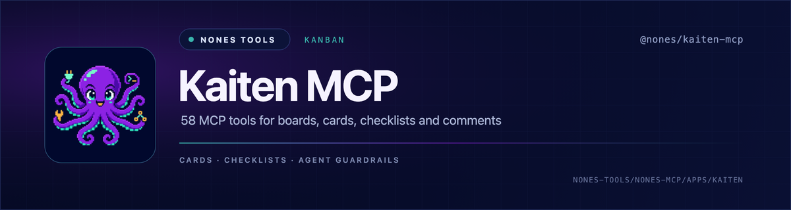

# Kaiten MCP has moved

Kaiten MCP is now developed in the
[Nones MCP monorepo](https://github.com/nones-tools/nones-mcp/tree/main/apps/kaiten).
The npm package name is unchanged: **`@nones/kaiten-mcp`**, with the same
`kaiten` binary and MCP tools.

## Migrate

- Install and run as before: `npx -y @nones/kaiten-mcp mcp`, or `kaiten mcp`
  after a global install.
- Upgrading from v3? The separate `kaiten-mcp` binary was removed in 4.0.0;
  append `mcp` to the command in your MCP config.
- Full setup, guardrails and configuration:
  [apps/kaiten/README.md](https://github.com/nones-tools/nones-mcp/blob/main/apps/kaiten/README.md)
  and [docs](https://github.com/nones-tools/nones-mcp/tree/main/apps/kaiten/docs).
- Changelog:
  [apps/kaiten/CHANGELOG.md](https://github.com/nones-tools/nones-mcp/blob/main/apps/kaiten/CHANGELOG.md).

## History

- Legacy repository: [nones-tools/kaiten-mcp](https://github.com/nones-tools/kaiten-mcp).
- Preserved history branch:
  [legacy/kaiten-master](https://github.com/nones-tools/nones-mcp/tree/legacy/kaiten-master).
- Monorepo architecture:
  [ARCHITECTURE.md](https://github.com/nones-tools/nones-mcp/blob/main/ARCHITECTURE.md).
