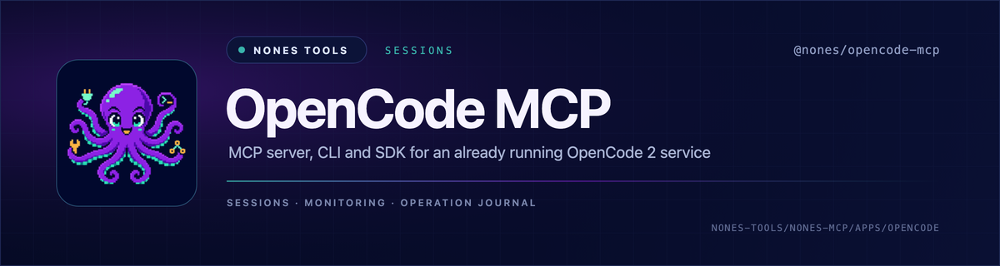

# OpenCode MCP has moved

OpenCode MCP is now developed in the
[Nones MCP monorepo](https://github.com/nones-tools/nones-mcp/tree/main/apps/opencode).
The npm package name is unchanged: **`@nones/opencode-mcp`**, with both
`opencode-mcp` and `oc2-mcp` bin aliases.

## Migrate

- Install as before: `npm install -g @nones/opencode-mcp`, then run
  `opencode-mcp mcp` or `opencode-mcp doctor`.
- The compatibility target, session CLI, journal and configuration variables
  are unchanged; read
  [apps/opencode/README.md](https://github.com/nones-tools/nones-mcp/blob/main/apps/opencode/README.md).
- Specification and docs:
  [apps/opencode/docs](https://github.com/nones-tools/nones-mcp/tree/main/apps/opencode/docs).
- Changelog:
  [apps/opencode/CHANGELOG.md](https://github.com/nones-tools/nones-mcp/blob/main/apps/opencode/CHANGELOG.md).

## History

- Legacy repository: [nones-tools/opencode-mcp](https://github.com/nones-tools/opencode-mcp).
- Preserved history branch:
  [legacy/opencode-main](https://github.com/nones-tools/nones-mcp/tree/legacy/opencode-main).
- Monorepo architecture:
  [ARCHITECTURE.md](https://github.com/nones-tools/nones-mcp/blob/main/ARCHITECTURE.md).
